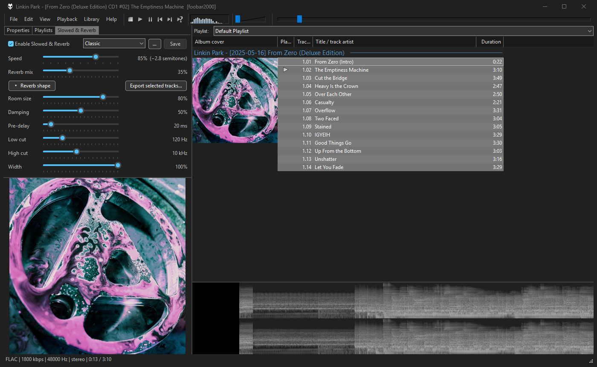
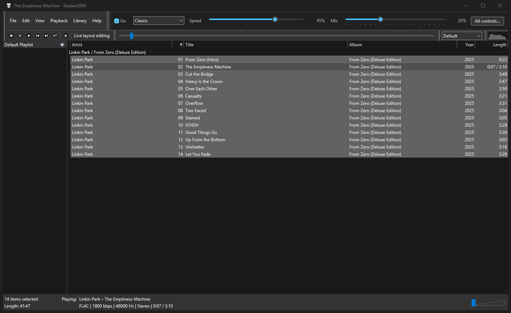
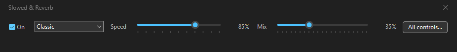
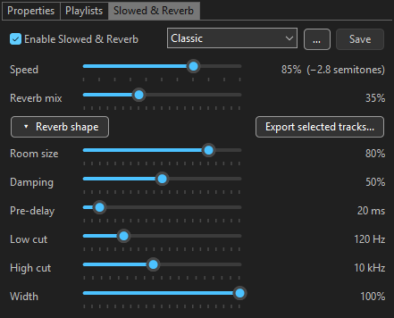
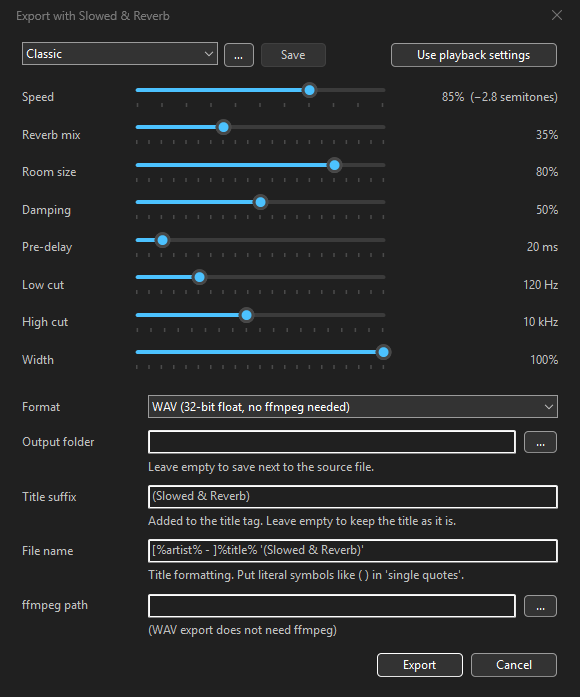

<h1 align="center">Slowed &amp; Reverb for foobar2000</h1>

<p align="center">
  The Slowed &amp; Reverb sound on your own music library: live while it plays, and exported to files with tags and cover art.
</p>

<p align="center">
  <a href="https://github.com/KimHerV/foo_slowed_reverb/releases/latest"></a>
  <a href="https://github.com/KimHerV/foo_slowed_reverb/releases"></a>
  <a href="https://github.com/KimHerV/foo_slowed_reverb/actions/workflows/build.yml"></a>
  
  <a href="LICENSE"></a>
</p>

<p align="center">
  <a href="https://github.com/KimHerV/foo_slowed_reverb/releases/latest/download/foo_slowed_reverb.fb2k-component"></a>
  <br>
  <sub>Then in foobar2000: Preferences &gt; Components &gt; Install..., pick the file, Apply.</sub>
</p>



## Features

- **Slowed:** varispeed slowdown from 50% to 100%. Pitch drops together with tempo, like playing a record slower. The pitch change is shown in semitones next to the value.
- **Reverb:** mix, room size, damping, pre-delay, low cut, high cut and stereo width.
  - **Pre-delay** separates the voice from the reverb so vocals stay clear.
  - **Low cut** keeps bass out of the reverb so it doesn't get muddy.
  - **High cut** softens the reverb's top end for the darker, hazier sound of Slowed & Reverb edits.
- **Sliders that snap:** every slider has ticks and snaps to them while you drag (5% steps; 10 ms for pre-delay, 25 Hz for low cut, 1 kHz for high cut).
  - **Double-click a value** to type an exact one: `83`, `-3st` (three semitones down), `0.8x`, `25ms`, `1k`, `off`.
  - **Mouse wheel**, **arrow keys** and **Page Up/Down** work as on any Windows slider.
- **Presets:** Light, Classic and Dreamy built in, plus your own.
  - The current preset's name is always shown, with `*` once you change something.
  - Save, Save as, Rename, Delete, Revert, and import/export as `.srpreset` files to share.
- **Live control:** sliders apply immediately while the music plays.
- **On/off without losing your chain:** switching off bypasses the effect but keeps it, and its position, in the DSP chain.
- **Three places to control it:**
  - the DSP Manager settings
  - a Layout panel
  - Playback > Enable Slowed & Reverb (assignable to a keyboard shortcut or a toolbar button)
- **Export:** right-click tracks > Slowed & Reverb > Export..., or select tracks and click **Export selected tracks...** in the panel.
  - Formats: MP3 320k, FLAC 24-bit, OGG Vorbis, M4A/AAC, or WAV 32-bit float. WAV is the default because it needs nothing else.
  - Tags and cover art are copied from the source, for WAV too. The title tag and the file name get "(Slowed & Reverb)" added; you can change or remove the title suffix in the export dialog.
  - Volume is lowered automatically if the reverb would clip.
- **Default UI and Columns UI:** a panel for either. In Columns UI it can also go in the toolbar area.

  

- **Panel layouts:** a full panel, or a one-row compact panel (right-click the panel).
- **Native Windows controls:** checkbox, combo box, buttons and sliders, following foobar2000's (or Columns UI's) dark/light mode.
  - Windows has no dark slider, so in dark mode the sliders are painted in the accent color.
  - The accent follows your foobar2000 highlight color if you changed it, otherwise the Windows accent color.
  - You can also pick your own color (right-click the panel).



## Requirements

- foobar2000 v2.0 or newer. x86, x64 and ARM64EC builds are included; foobar2000 for ARM uses the native ARM64EC build.
- [ffmpeg](https://ffmpeg.org/) for MP3/FLAC/OGG/M4A export.
  - The component finds ffmpeg on `PATH` or a WinGet install (`winget install ffmpeg`).
  - You can also set its path in the export dialog.

> [!TIP]
> No ffmpeg? Export to WAV, the default format. It needs nothing else and keeps the tags and cover art.

## Install

1. [Download the latest version](https://github.com/KimHerV/foo_slowed_reverb/releases/latest/download/foo_slowed_reverb.fb2k-component), or pick one from the [Releases](https://github.com/KimHerV/foo_slowed_reverb/releases) page.
2. In foobar2000, open Preferences > Components > Install..., pick the file, then click Apply and restart.

## Usage

**Playback**
1. Go to Preferences > Playback > DSP Manager.
2. Add **Slowed & Reverb** to the active list.
3. Double-click it, or press the configure button, to open its settings.

**Panel**
1. Turn on View > Layout > Enable layout editing mode.
2. Right-click where you want the panel, then Add New UI Element > Utility > **Slowed & Reverb**.
3. If you'd rather not edit the layout, View > Slowed & Reverb opens the same panel as a window.
4. Right-click the panel for the compact layout and the slider color.
5. Click **Reverb shape** to show or hide its six sliders.
6. **Columns UI:** add **Slowed & Reverb** from the Panels list in Preferences > Columns UI > Layout, or right-click the toolbar area > Panels.



**Export**
1. Select tracks, right-click, then choose Slowed & Reverb > Export... You can also select tracks in the playlist and click **Export selected tracks...** in the full panel.
2. **Use playback settings** copies what you're currently listening to.
3. Leave the output folder empty to save next to the source files.
4. In the file name pattern, put literal symbols like `( )` in single quotes. That is how foobar2000 title formatting works.



## Notes

- **Track duration:** the playlist shows the original length. Slowed playback takes longer than that.
- **Reverb tail:** the end of a playlist and exported files keep the reverb ringing out, up to 8 seconds.
- **Settings from older builds:** they load unchanged. Pre-delay and low cut start at 0, high cut off and width at 100%, so they sound exactly as before.
- **Your presets are saved immediately.** Saving, renaming or deleting a preset inside the DSP settings window takes effect at once. Cancelling that window only reverts the DSP settings, not your preset list.

## Building

<details>
<summary>Build it yourself (Visual Studio, foobar2000 SDK, Columns UI SDK)</summary>

Requirements:
- Visual Studio 2022 with the C++ desktop workload. The optional native ARM64EC build (`build.cmd arm64ec`) needs the "MSVC v143 ARM64/ARM64EC build tools" component. It goes in the package's `arm64ec\` folder, which foobar2000 for ARM prefers over `x64\`.
- The [foobar2000 SDK](https://www.foobar2000.org/SDK) (SDK-2026-10-01).
- The [Columns UI SDK](https://github.com/reupen/columns_ui-sdk) (v8.1.0), extracted into the foobar2000 SDK folder as `columns_ui-sdk`.

Layout:
```
<parent>\
├─ _SDK\SDK-2026-10-01\    (extracted SDK; not part of this repository)
│  ├─ foobar2000\, pfc\, ...
│  └─ columns_ui-sdk\      (Columns UI SDK)
└─ foo_slowed_reverb\      (this repository)
```

Steps:
1. Build the SDK libraries once for each platform you need, for example `..\_SDK\build_sdk.cmd x64 Win32 ARM64EC`. Alternatively, build `pfc`, `foobar2000_SDK` and `foobar2000_component_client` in Release with MSBuild.
2. Run `build.cmd all`, or `build.cmd x64` for one architecture. The package is written to `build\foo_slowed_reverb.fb2k-component`.
3. Set `SDK_DIR` if the SDK is somewhere else.

CI (`.github/workflows/build.yml`) downloads both SDKs and builds the libraries itself instead of using `build_sdk.cmd`. If you change an SDK version, update it in both places.

The README screenshots are taken with `tools\screenshots.ps1`; [docs/SCREENSHOTS.md](docs/SCREENSHOTS.md) explains the setup.

The DSP core (`src/slowed_reverb_core.h`) has no foobar2000 dependencies. Test it with `test\build_test.cmd` followed by `test\test_core.exe`.

</details>

## Credits

- Reverb is based on **Freeverb** by Jezar at Dreampoint (public domain).
- Built with the foobar2000 SDK by Peter Pawlowski and the Columns UI SDK by Reupen Shah.

## License

[MIT](LICENSE) © 2026 KimHerV
